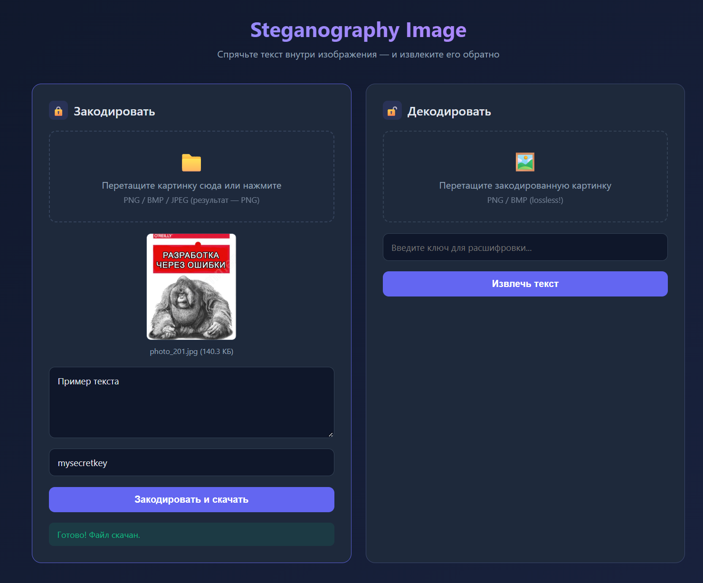
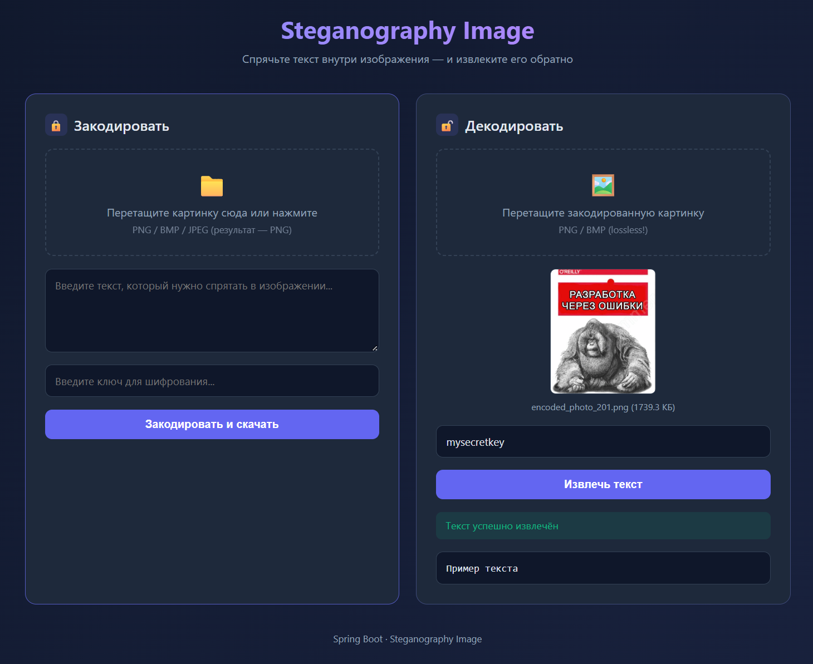

# 🖼️ Steganography Image

Веб-приложение на Spring Boot для сокрытия текста внутри изображений методом LSB (Least Significant Bit) с использованием библиотеки [Adumbra](https://github.com/galliumdata/adumbra).

Пользователь загружает картинку, вводит текст и секретный ключ — на выходе получает PNG с зашифрованным сообщением. Обратная операция извлекает текст по тому же ключу.

---

## ✨ Возможности

- 🔒 **Кодирование** — спрятать произвольный текст в изображении
- 🔓 **Декодирование** — извлечь текст по секретному ключу
- 🎨 **Веб-интерфейс** — drag-and-drop загрузка, превью, скачивание результата
- ✅ **Валидация** — Bean Validation на DTO (длина ключа, пустые поля)
- ⚙️ **Конфигурируемость** — уровень скрытности и лимиты через `application.properties`
- 🧪 **Покрытие тестами** — unit-тесты для валидации и round-trip

---
## Скриншоты

<table>
  <tr>
    <td align="center"><b>Главная страница</b></td>
  </tr>
  <tr>
    <td></td>
  </tr>
</table>

<table>
  <tr>
    <td align="center"><b>Закодировать текст</b></td>
    <td align="center"><b>Декодировать текст</b></td>
  </tr>
  <tr>
    <td></td>
    <td></td>
  </tr>
</table>

## 🛠️ Стек

| Слой | Технология |
|---|---|
| Backend | Java 17+, Spring Boot 3.x |
| Steganography | Adumbra 0.8 |
| Валидация | Jakarta Bean Validation (Hibernate Validator) |
| Frontend | Vanilla HTML/CSS/JS (без сборки) |
| Тесты | JUnit 5, AssertJ, Mockito |

---

## 📂 Структура проекта

```
src/main/java/com/github/reactivity512/steganography_image/
├── SteganographyImageApplication.java # @SpringBootApplication
├── controller/
│ └── SteganographyController.java # REST-эндпоинты /api/encode, /api/decode
├── service/
│ └── SteganographyService.java # Оркестрация encode/decode
├── dto/
│ ├── request
│      ├── EncodeRequest.java # DTO с аннотациями валидации
│      └── DecodeRequest.java
│ └── error
│      └── ApiError.java # Единый формат ошибки
├── exception/
│ ├── ValidationException.java
│ ├── SteganographyException.java
│ └── GlobalExceptionHandler.java # @RestControllerAdvice
├── validation/
│ ├── ValidKeyLength.java # Кастомная аннотация
│ └── KeyLengthValidator.java # Проверка длины ключа по конфигу
└── config/
     └── SteganographyProperties.java # @ConfigurationProperties

src/main/resources/
├── static/
│ └── index.html # Веб-интерфейс
└── application.properties
```


---

## 🚀 Запуск

### Требования
- JDK 17+
- Maven 3.8+

### Локальный запуск

```bash
git clone https://github.com/reactivity512/steganography-image.git
cd steganography-image
mvn spring-boot:run
```

Откройте http://localhost:8080.

### Сборка JAR

```bash
mvn clean package
java -jar target/steganography-image-*.jar
```

---

## ⚙️ Конфигурация

`src/main/resources/application.properties:`

```properties
# Уровень скрытности Adumbra: 1 (быстрее) или 2 (максимальная скрытность)
steganography.secure-level=2

# Допустимая длина ключа (в байтах UTF-8)
steganography.min-key-bytes=16
steganography.max-key-bytes=256

# Spring Boot: лимиты загрузки файлов
spring.servlet.multipart.max-file-size=10MB
spring.servlet.multipart.max-request-size=10MB
```

Все параметры валидируются при старте (@Validated + @Min/@Max). Некорректный конфиг → приложение не запустится.

---

## 🔌 REST API

**POST** `/api/encode`
Спрятать текст в изображении.

Request (`multipart/form-data`):

| Поле  | Тип  | Описание                            |
|-------|------|-------------------------------------|
| `image` | file | Исходное изображение (PNG/BMP/JPEG) |
| `text`  | text | Теtext	string	Текст для сокрытия (≤ 32 КБ) |
| `key`   | text | Секретный ключ (16–256 байт)        |

Response: `image/png` — закодированное изображение (`Content-Disposition: attachment`).

Ошибки: `400` — невалидный ввод, `413` — файл больше 10 МБ, `500` — внутренняя ошибка.

**POST** `/api/decode`

Извлечь текст из изображения.

Request (`multipart/form-data`):

| Поле    | Тип    | Описание                                     |
|---------|--------|----------------------------------------------|
| `image` | file   | Изображение, закодированное ранее (PNG/TIFF) |
| `key`   | string | Тот же ключ, что при кодировании             |

Response: `text/plain` — извлечённый текст.

Ошибки: `400` — неверный ключ / сообщение не найдено / битый файл.

**Формат ошибок**

Единый JSON во всех случаях:
```json
{
  "message": "Ключ слишком короткий (минимум 16 байт)",
  "status": 400
}
```

---

## ⚠️ Важные ограничения

- **Только lossless-форматы.** Декодировать можно только **PNG** или **TIFF**. JPEG уничтожает LSB-данные при сжатии — сообщение будет безвозвратно испорчено.
- **Объём сообщения ограничен.** Adumbra вмещает примерно 1 байт на 500 пикселей, максимум 32 КБ. Для картинки 1000×1000 это ~2 КБ текста.
- **Размер файла растёт.** Изображение после кодирования может весить в 5–15 раз больше исходного — это плата за «шумный» PNG и уровень secureLevel=2.
- **Ключ не хранится.** Забыли ключ — данные не восстановить.

---

## 🧪 Тесты

```bash
mvn test
```

Покрыто:

- `EncodeRequestValidationTest` / `DecodeRequestValidationTest` — все ветки Bean Validation, включая кастомный `@ValidKeyLength`
- `SteganographyServiceTest` — round-trip (ASCII, кириллица), формат PNG, неверный ключ, чистая картинка, мусорные байты
- `SteganographyImageApplicationTests` — smoke-тест загрузки контекста

---

## 🔐 Безопасность

- Ключ никогда не логируется и не сохраняется на сервере.
- Ошибки Adumbra не пробрасываются наружу — пользователь получает обобщённое сообщение, stack trace остаётся в логах.
- Лимит загрузки 10 МБ защищает от DoS через большие файлы.
- **Steganography ≠ Encryption.** Adumbra скрывает факт наличия данных, но не является заменой шифрованию. Для конфиденциальности комбинируйте со шифрованием текста до кодирования (например, AES-GCM).

---

## 📚 Используемые библиотеки

- [Adumbra](https://github.com/galliumdata/adumbra) — LSB-стеганография для битмапов
- [Spring Boot](https://spring.io/projects/spring-boot)
- [Jakarta Bean Validation](https://beanvalidation.org/)

---

## 📄 Лицензия

MIT — используйте свободно.

